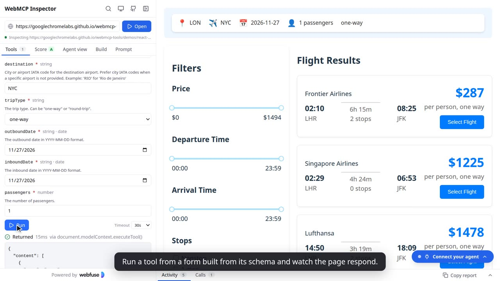

# WebMCP Inspector

Inspect, test and improve the [WebMCP](https://webmachinelearning.github.io/webmcp/) tools of any web page: run them, let models use them in a prompt debugger, check with evals that a model picks the right tool, and hand the live page to your own agent.

There is no browser extension to install and nothing to change on the site. Paste a URL and the page opens in a [Webfuse](https://www.webfuse.com) session embedded right next to the inspector. The page uses the browser's own WebMCP where it has one (Chrome), and Webfuse's polyfill everywhere else.

[](https://webmcpinspector.com/inspect/demo.mp4)

▶ [Watch the 77-second demo](https://webmcpinspector.com/inspect/demo.mp4): open a page, run a tool, watch the tool list update, then the Score, Agent view, Build, Prompt and Connect your agent panels.

Live: [webmcpinspector.com](https://webmcpinspector.com) · Test page that uses every WebMCP feature: [`kitchen-sink.html`](https://webmcpinspector.com/inspect/fixtures/kitchen-sink.html)

## Status

Version 2.0.0, rebuilt in November 2026 for the current WebMCP spec (`document.modelContext`, `getTools()` / `executeTool()`, `AbortSignal` removal, `outputSchema`, the four tool annotations).

### What works where

| Browser | Form tools | Script tools |
| :- | :- | :- |
| Chrome with built-in WebMCP (for example Chrome 151) | Yes | Yes, through Chrome's own WebMCP |
| Without built-in WebMCP (Firefox, Safari, Chrome without WebMCP) | Yes | Yes, through the Webfuse polyfill |

If a browser ever blocks WebMCP in the session's frame, the Tools panel and the Score panel say so, and only form tools are listed.

### How the session is embedded

The inspector loads the Space link (`VITE_SPACE_URL`, by default `https://webfu.se/+webmcpinspector/`) straight into its own iframe. Opening a Space link starts a new session, so the inspector does not use the Webfuse widget.

This matters for Chrome. Chrome only lets a page inside frames use its built-in WebMCP when every frame above it grants the `tools` permission. The widget creates the session frame itself, and its `allow` list has no `tools`, so Chrome rejects every `registerTool()` call and pages that declare tools from script show none. Because the inspector owns its iframe, it sets the list itself:

```html
<iframe src="https://webfu.se/+webmcpinspector/"
        allow="tools *; clipboard-read; clipboard-write; fullscreen; microphone; camera; display-capture; encrypted-media; autoplay">
```

The inspector then drives the session over the same `postMessage` API the widget uses (`src/app/sessionFrame.ts`):

- **Commands** go to the session frame as `api_request` messages: `get_session_info`, `get_session_tabs`, `open_tab`, `relocate_tab`, `activate_tab`, `close_tab` and `end`.
- **Messages for the extension** inside the page go as `widget_message` with `target: "user"`, and the extension's replies come back the same way.
- **Session events** such as `tab_relocated`, `tab_opened` and `session_ended` arrive as `widget_event` and `cobro_event` messages.

Only the extension inside the page still uses the widget API (`webfuse.currentSession`), which is why it needs the Space's widget key and ID.

### Known limitations

- **Connect your agent** needs the **Automation** app in the Webfuse Space, and the Space's Automation key in `VITE_AUTOMATION_KEY` at build time. Without the app, agents cannot reach the session. Without the key, each visitor has to paste one.
- **The session's `postMessage` API is internal to Webfuse.** It is the one the Webfuse widget uses, not a documented public API, so a Webfuse update could change it.
- **Only the top frame is read.** Tools registered inside iframes are listed as frames, not as tools.
- **Script tools you add** in the Build panel run through `new Function()`, so pages whose Content Security Policy forbids `eval` refuse them. The inspector shows the error.
- **Form tools return an acknowledgement**, not the page's response, unless the page answers with `SubmitEvent.respondWith()`.
- **Gemini Nano** needs desktop Chrome 148 or later on supported hardware. Its built-in tool calling is still behind `chrome://flags/#prompt-api-tool-use`, so the text protocol is the default.
- **Model names** for OpenAI and Gemini are editable defaults (`gpt-5`, `gemini-3.6-flash`), not a maintained list.

## Features

### Tools panel
- **Script tools** from `document.modelContext.registerTool()`, with title, description, annotations (`readOnlyHint`, `consequentialHint`, `untrustedContentHint`, `debugging`), input and output schemas, and `exposedTo`.
- **Form tools** declared with `toolname`, `tooldescription`, `toolautosubmit` and `toolparamdescription`. The schema shown is the one the browser derives, or the inspector's estimate when the browser does not list the form. The estimate covers radio groups, checkbox groups, multi-selects, formats, lengths, patterns and number ranges.
- **Other forms** on the page, ready to be turned into tools.
- **Where WebMCP comes from:** the browser's own or the Webfuse polyfill, and whether the frame may use it.
- **Live updates:** the list follows `toolchange`, tools removed by aborting their `AbortSignal`, and DOM changes to forms.
- **Legacy API:** tools registered on the old `navigator.modelContext` are flagged.
- **Locate:** scrolls to a form on the page and outlines it. A scan marks the page's tool forms without moving the page.
- **Filter** tools and forms by name or description.

### Running tools
- **Argument editor** built from the schema, including nested objects, arrays, enums, booleans and date, email and URL fields. It also has a JSON mode and an **Example** button that fills every field from the schema.
- **Validation:** arguments are checked against the input schema, and results against the output schema.
- **Cancel and timeout:** **Cancel** aborts the tool's `signal`. The timeout is adjustable from 5 to 120 seconds.
- **Warnings:** tools marked `consequentialHint` show a warning that the call acts on the real site.
- **Results** show the value, the duration and which API ran the call (`executeTool()`, the testing API, the tool's own `execute()`, or the inspector filling the form).
- **Form filling** works with React and other frameworks, and submits only when `toolautosubmit` allows it.

### Score
A score from 0 to 100 and a grade from A to F, from 35 checks:
- **names:** invalid, starting with something other than a letter, reserved by Webfuse, or duplicated, including a script tool that hides a form tool of the same name;
- **descriptions:** missing, too short or too long, containing invisible or direction-changing Unicode, or reading like instructions to the agent;
- **schemas:** invalid, a non-object input schema, untyped or undocumented parameters, `null` type unions, and a missing or invalid output schema;
- **safety hints:** a tool that looks consequential without `consequentialHint`, and `readOnlyHint` that contradicts the tool or is combined with `consequentialHint`;
- **forms:**
  - a `toolname` without `tooldescription`;
  - fields without a name or a description;
  - radio groups without a description;
  - the obsolete `toolparamtitle`;
  - `toolautosubmit` on a POST form;
  - no submit button;
  - forms the browser does not register;
- **the page:** forms not exposed as tools, cross-origin iframes without `allow="tools"`, no WebMCP API at all, and a blocked `tools` permission.

Copy the report as Markdown, or a "WebMCP ready" badge as SVG.

### Agent view
Shows each tool as the page registered it, next to the copy an MCP client receives from the Webfuse Session MCP Server. The server:
- adds a required `session_id` parameter;
- prefixes each description to mark it as page-declared and untrusted;
- removes `null` from type unions;
- drops the title, the output schema and the hints MCP has no field for;
- leaves out tools with reserved or invalid names and tools whose input schema is not an object.

### Connect your agent
One button opens Claude Desktop, Claude Code, Codex, Cursor or Zed with a prompt already filled in. **Copy prompt** works for any other agent. Nothing is sent until you press Enter in the app.

The prompt contains:
- the session ID and the page URL;
- the MCP server in dynamic mode, which is the mode that lists the page's own tools;
- the setup line for that agent;
- an HTTP fallback for agents that only load MCP servers at startup.

It suggests a first task from the page's tools. It also tells the agent to call `connectToSession` first, to prefer the page's tools, and to treat their output as untrusted.

The links are the same intent links as the [Webfuse agent playground](https://playground.x.aogz.me).

### Build and export
- **Script tools:** write a tool (name, title, description, input and output schemas, annotations, `execute` body) and register it in the live page. Tools are saved per page and come back on every visit. You can switch them off, edit or delete them.
- **Form augmentation:** turn any form into a tool, or fix the attributes of one that already is. Changes are saved per page in your browser and reapplied when the page loads.
- **Export:**
  - the form markup to add to the site;
  - a `registerTool()` snippet with feature detection;
  - a Webfuse extension (`manifest.json` and `content.js`) that applies your form changes and script tools for every visitor of a Space, without changing the site.

### Prompt debugger and evals
The **Prompt** panel lets a language model use the page's tools, so you see how an agent reads them before you ship.

- **Models:** Gemini Nano on the device, Claude (Opus 5.5, Sonnet 5.5 or Haiku 5.5), OpenAI or Gemini. API providers use your own key, which stays in your browser and goes only to that provider. Claude calls use server-side refusal fallbacks (`fallbacks: "default"`). Gemini Nano can use the Prompt API's built-in tool calling where Chrome has it turned on.
- **Chat:** ask for something in plain words and the model calls the page's tools to do it. Every call and result shows in the conversation and in the Calls log. Tools with `consequentialHint` ask you before they run.
- **Evals:** a set of test cases for the page. Each case is a request, the tool the model should call (or none), and the arguments it should pass, matched partially and case-insensitively. Running the set records what the model calls without running the tools, and shows which cases pass. Cases are saved per page and can be imported and exported as JSON, so you can rerun them after changing a tool's description or schema, or compare models.
- **Injection test:** appends hostile text to every tool result, the way a malicious review or product description would arrive, and reports whether the model then called tools you did not ask for.

### Activity and calls
- **Activity log:** session events, tool discovery, registrations and removals, `toolactivated` / `toolcancel`, agent submissions and `respondWith()`, augmentations and errors. Filter by kind, expand an entry for details, export as JSON.
- **Calls:** every call from the sidebar, the prompt debugger and evals. Replay any call, diff its result with the previous call to the same tool, or export them all.
- **Copy report:** page, WebMCP implementation, browser, tools, recent calls and activity as Markdown, ready to paste into a bug report.

### Workflow
- **Links to an inspection:** `/inspect/?url=<page>` opens the inspector and starts a session on that page right away, for example [`/inspect/?url=https://googlechromelabs.github.io/webmcp-tools/demos/french-bistro/`](https://webmcpinspector.com/inspect/?url=https%3A%2F%2Fgooglechromelabs.github.io%2Fwebmcp-tools%2Fdemos%2Ffrench-bistro%2F). The address bar follows the page you are inspecting, so copying it shares the inspection; the command palette also has "Copy a link that opens this page in the inspector".
- **URL bar:** remembers recent pages with their titles, and refuses `localhost` URLs, which Webfuse cannot reach.
- **Themes:** light and dark, following the system unless you choose one.
- **Keyboard:** a command palette (<kbd>Ctrl</kbd>/<kbd>⌘</kbd>+<kbd>K</kbd>) for every panel and tool, <kbd>/</kbd> to jump to the URL bar and <kbd>R</kbd> to scan again.
- **Layout:** a collapsible sidebar, and a stacked layout on narrow screens.
- **Version check:** the inspector notices when the Space runs an older extension.
- **Privacy:** analytics receive only the inspected page's host name, never its full URL.

## Getting Started

You need Node.js 22 or later.

```bash
git clone https://github.com/aogz/webmcpinspector.git
cd webmcpinspector
npm install
cp .env.example .env
npm run dev
```

Open <http://localhost:5173/inspect/>.

### Configuration

The settings live in `.env`. Without one, the app uses the public webmcpinspector.com Space.

| Variable | What it does |
| :- | :- |
| `VITE_SPACE_URL` | The Space link the inspector embeds, such as `https://webfu.se/+webmcpinspector/`. Opening it starts a new session. The Space needs this repository's extension, and the **Automation** app for Connect your agent. |
| `VITE_WIDGET_KEY`, `VITE_SPACE_ID` | The same Space's widget key and ID. Only the extension uses them, inside the page; the app itself does not load the Webfuse widget. |
| `VITE_AUTOMATION_KEY` | The Space's Automation key (`ak_…`), used by Connect your agent for every visitor. Find it in Webfuse Studio on the Space's **Developers** page, under **API**; installing the Automation app creates it. Never commit it: set it in `.env` or as a build argument. Vite builds it into the page, so anyone who opens the inspector can read it; use a Space made for this. If you leave it empty, visitors paste their own. |
| `VITE_MCP_URL` | Session MCP endpoint, when it is not `https://session-mcp.<session host>/mcp`. |

All `VITE_*` values are read when the app is built, not when it runs, so changing one means building again.

The `VITE_SPACE_URL_DEV`, `VITE_WIDGET_KEY_DEV` and `VITE_SPACE_ID_DEV` names also work in `npm run dev`.

The inspector embeds the Space link instead of using the Webfuse widget; see [How the session is embedded](#how-the-session-is-embedded).

The Space's frame ancestors list must include the host the inspector runs on. A host given without a port only matches the default port, so `127.0.0.1` does not cover `127.0.0.1:5173`.

### The Webfuse extension

The inspector reads the page through a small Webfuse extension in `src/extension/`. Build it with:

```bash
npm run build:extension
```

Then update the extension in the Space with `dist/extension` (`manifest.json` and `content.js`). In Webfuse Studio, open the Space, choose **Manage** under Extensions, select the extension and use **Refresh extension**. `npm run dev:extension` rebuilds it on every change.

The build uses the widget key and Space from `.env`, so build without a `.env` (or with production values) for the public Space.

The app and the extension speak a versioned protocol (`src/shared/protocol.ts`). If the Space runs an older extension, the inspector asks you to upload the new one.

### Scripts

| Command | What it does |
| :- | :- |
| `npm run dev` | Development server for the app |
| `npm run dev:extension` | Rebuilds the extension on every change |
| `npm run build` | Typecheck, then build the app and the extension into `dist/` |
| `npm run build:extension` | Build only the extension |
| `npm test` | Unit tests, panel render tests, and an integration test of the content script in happy-dom |
| `npm run lint` | ESLint |
| `npm run typecheck` | TypeScript |

CI (`.github/workflows/ci.yml`) runs lint, tests and the build on every push and pull request, and keeps the built extension as an artifact.

### Docker

```bash
docker build -t webmcp-inspector --build-arg VITE_AUTOMATION_KEY=ak_… .
docker run -p 8080:80 webmcp-inspector
```

The build also accepts `VITE_SPACE_URL`, `VITE_WIDGET_KEY`, `VITE_SPACE_ID` and `VITE_MCP_URL` as build arguments. It runs the tests before building.

On Dokploy, set these under the application's **Environment → Build-time Arguments**, not as runtime environment variables, then redeploy. A runtime variable never reaches the built page.

The app is served at `/inspect/`, the landing page at `/`, and a health check at `/healthz`. The image's `HEALTHCHECK` calls `/healthz` on `127.0.0.1`. Orchestrators such as Docker Swarm only switch traffic to a new container once that check passes.

## Project Structure

```
src/
  App.tsx                 Layout, theme, keyboard shortcuts, command palette
  config.ts               Keys and endpoints from the environment
  app/
    store.ts              Session, messaging, calls, persistence (useSyncExternalStore)
    sessionFrame.ts       Embeds the Space link and drives the session over postMessage
    agentLinks.ts         Intent links and prompts for Connect your agent
    exporters.ts          HTML, registerTool() and Webfuse extension exports
    report.ts             The "Copy report" text
    storage.ts            localStorage, with migration of version 1 data
    llm/                  Gemini Nano, Claude, OpenAI and Gemini providers
  components/             Panels (Tools, Score, Agent view, Build, Prompt), Dock,
                          Connect your agent, URL bar, command palette, argument editor
  extension/
    content.ts            Runs in the page: reads tools and forms, runs calls, applies changes
    forms.ts              Form keys, fields, schema estimate, filling forms the way a user would
    overlay.ts            Highlights on the page
  shared/
    protocol.ts           Messages between the app and the extension
    types.ts              Snapshot, tool, form and call types
    lint.ts               Score checks
    agentView.ts          How the Webfuse Session MCP Server translates page tools
    webfuse.ts            Webfuse's reserved tool names and name rules
    jsonSchema.ts         Validation, schema checks, example values
  __tests__/              Vitest suites
public/
  demo.mp4, demo-poster.jpg
  extension/manifest.json
  fixtures/kitchen-sink.html
  landing.html
```

## Related Links

- [WebMCP specification](https://webmachinelearning.github.io/webmcp/) and [explainer](https://github.com/webmachinelearning/webmcp)
- [WebMCP in Chrome](https://developer.chrome.com/docs/ai/webmcp) and the [DevTools WebMCP panel](https://developer.chrome.com/docs/devtools/application/webmcp)
- [WebMCP tools and demos](https://github.com/GoogleChromeLabs/webmcp-tools)
- [Webfuse Session MCP Server](https://dev.webfuse.com/session-mcp-server) and [page-declared tools](https://dev.webfuse.com/custom-mcp-tools)

## Credits

The Claude, Codex and Cursor logos come from [LobeHub Icons](https://github.com/lobehub/lobe-icons) (MIT), and the Zed logo from [Simple Icons](https://simpleicons.org) (CC0). They are trademarks of Anthropic, OpenAI, Anysphere and Zed Industries.

## License

MIT
