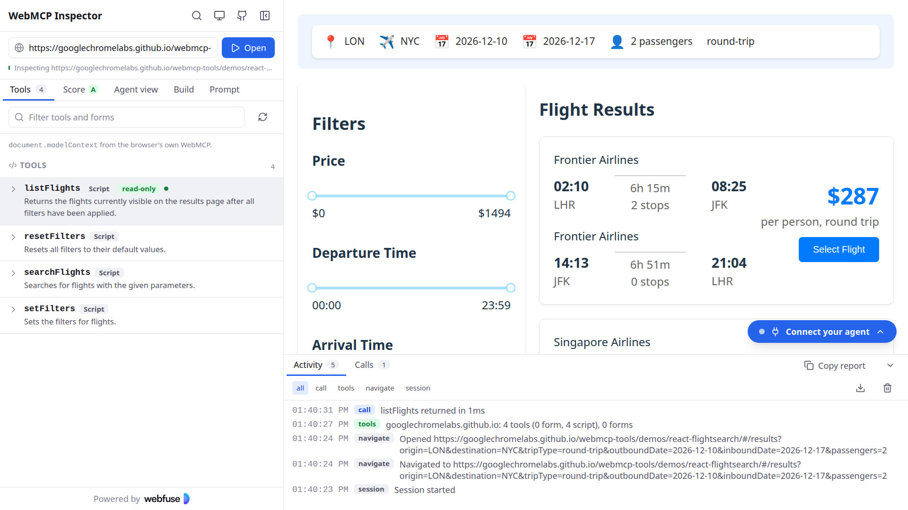

# WebMCP Inspector

Inspect, test and improve the [WebMCP](https://webmachinelearning.github.io/webmcp/) tools of any web page, then hand the live page to your own agent.

The page opens in a [Webfuse](https://www.webfuse.com) session next to the inspector. Webfuse gives every page `document.modelContext`, so this works in any browser, with no extension to install and no Chrome flag to set.



Live: [webmcpinspector.com](https://webmcpinspector.com) · Test page with every WebMCP feature: [`/inspect/fixtures/kitchen-sink.html`](https://webmcpinspector.com/inspect/fixtures/kitchen-sink.html)

## Features

### Tools
- **Script tools** registered with `document.modelContext.registerTool()`, with their title, annotations (`readOnlyHint`, `consequentialHint`, `untrustedContentHint`, `debugging`), input and output schemas, and `exposedTo`.
- **Form tools** declared with `toolname`, `tooldescription`, `toolautosubmit` and `toolparamdescription`. The schema shown is the one the browser derives, or the inspector's estimate if the browser does not list the form.
- **Live updates.** The list follows `toolchange`, tools removed by aborting their `AbortSignal`, `toolactivated`/`toolcancel`, and `SubmitEvent.agentInvoked` with `respondWith()`.
- **Where WebMCP comes from:** native, or the Webfuse polyfill. Tools registered on the old `navigator.modelContext` are flagged.

### Running tools
- A form built from the schema, including nested objects, arrays and enums. It also has a JSON mode and an "example" button that fills every field.
- Inputs are checked against the input schema, and results against the output schema.
- Calls can be cancelled, which aborts the tool's `signal`, and each call has a timeout you set.
- Every call is recorded in a history. You can replay a call, or diff it with the previous call to the same tool.

### Readiness
A score from A to F, with findings for:
- names: invalid, reserved by Webfuse, or duplicated;
- descriptions: missing, too short or too long, invisible Unicode, or text that reads like instructions to the agent;
- schemas: invalid, a non-object input schema, or undocumented parameters;
- safety hints: a tool that looks consequential but has no `consequentialHint`, or `readOnlyHint` that contradicts the tool;
- forms: radio groups without a description, the obsolete `toolparamtitle`, and `toolautosubmit` on POST forms;
- cross-origin iframes without `allow="tools"`.

You can copy the report as Markdown, or a badge as SVG.

### Agent view
Shows each tool as the page registered it, next to the copy an MCP client receives from the Webfuse Session MCP Server. The server:
- adds a `session_id` parameter;
- prefixes each description to mark it as page-declared and untrusted;
- removes `null` from type unions;
- drops hints that MCP has no field for;
- leaves out tools that have reserved names or invalid schemas.

### Connect your agent
One button opens Claude Desktop, Claude Code, Codex, Cursor or Zed with a prompt already filled in. The prompt connects the agent to this exact session over MCP in dynamic mode, which is the mode that lists the page's own tools, and tells it to call those tools. **Copy prompt** works for any other agent.

The links are the same intent links as the [Webfuse agent playground](https://playground.x.aogz.me).

### Author and export
- **Script tools:** write a tool (name, schemas, annotations, `execute` body) and register it in the live page. It is kept per page and comes back on every visit.
- **Form augmentation:** turn any form into a tool, or fix the descriptions of one that already is.
- **Export:** the form markup, a `registerTool()` snippet with feature detection, or a Webfuse extension (`manifest.json` and `content.js`) that applies your changes for every visitor of a Space.

### Prompt debugger
- **Models:** Gemini Nano on the device (Chrome 148 or later), Claude (Opus 5.5, Sonnet 5.5 or Haiku 5.5), OpenAI or Gemini, each with your own API key.
- **Chat:** the model uses the page's tools. Tools with `consequentialHint` ask you before they run.
- **Evals:** each case pairs a request with the tool and arguments it should produce. The inspector checks what the model calls without running the tool. You can import and export the cases.
- **Injection test:** appends hostile text to each tool result and reports whether the model followed it.

API keys stay in your browser and go only to the provider you pick. Claude calls use server-side refusal fallbacks (`fallbacks: "default"`).

### Workflow
- Light and dark themes, which follow the system unless you choose one.
- A command palette (<kbd>Ctrl</kbd>/<kbd>⌘</kbd>+<kbd>K</kbd>), plus <kbd>/</kbd> to jump to the URL bar and <kbd>R</kbd> to scan again.
- An activity log with filters, JSON export and a "copy report" button for bug reports.

## Getting Started

You need Node.js 22 or later.

```bash
git clone https://github.com/aogz/webmcpinspector.git
cd webmcpinspector
npm install
cp .env.example .env
npm run dev
```

Open <http://localhost:5173/inspect/>.

### Configuration

The settings live in `.env`. Without one, the app uses the public webmcpinspector.com Space.

| Variable | What it does |
| :- | :- |
| `VITE_WIDGET_KEY`, `VITE_SPACE_ID` | Webfuse widget key and Space. The Space needs the **Automation** app and this repository's extension. |
| `VITE_AUTOMATION_KEY` | The Space's Automation key (`ak_…`), used by Connect your agent. Anyone who opens the inspector can read it, so use a Space made for this. If you leave it empty, visitors paste their own. |
| `VITE_MCP_URL` | Session MCP endpoint, when it is not `https://session-mcp.<session host>/mcp`. |

The `VITE_WIDGET_KEY_DEV` and `VITE_SPACE_ID_DEV` names from version 1 still work in `npm run dev`.

### The Webfuse extension

The inspector reads the page through a small Webfuse extension, `src/extension/`. Build it with:

```bash
npm run build:extension
```

Then upload `dist/extension` (`manifest.json` and `content.js`) to the Space in Webfuse Studio. While you work on it, `npm run dev:extension` rebuilds it on every change.

The app and the extension speak a versioned protocol (`src/shared/protocol.ts`). If the Space runs an older extension, the inspector tells you to upload the new one.

### Scripts

| Command | What it does |
| :- | :- |
| `npm run dev` | Development server for the app |
| `npm run build` | Typecheck, then build the app and the extension into `dist/` |
| `npm test` | Unit tests, plus an integration test of the content script in happy-dom |
| `npm run lint` | ESLint |

### Docker

```bash
docker build -t webmcp-inspector --build-arg VITE_AUTOMATION_KEY=ak_… .
docker run -p 8080:80 webmcp-inspector
```

The app is served at `/inspect/`, the landing page at `/`, and a health check at `/healthz`.

## Project Structure

```
src/
  App.tsx                 Layout, theme, keyboard shortcuts, command palette
  config.ts               Keys and endpoints from the environment
  app/
    store.ts              Session, messaging, calls, persistence (useSyncExternalStore)
    agentLinks.ts         Intent links and prompts for Connect your agent
    exporters.ts          HTML, registerTool() and Webfuse extension exports
    storage.ts            localStorage, with migration of version 1 data
    llm/                  Gemini Nano, Claude, OpenAI and Gemini providers
  components/             Panels: Tools, Readiness, Agent view, Author, Prompt; Dock; Connect your agent
  extension/
    content.ts            Runs in the page: reads tools and forms, runs calls, applies changes
    forms.ts              Form keys, fields, schema estimate, filling forms the way a user would
    overlay.ts            Highlights on the page
  shared/
    protocol.ts           Messages between the app and the extension
    lint.ts               Readiness rules and score
    agentView.ts          How the Webfuse Session MCP Server translates page tools
    jsonSchema.ts         Validation, schema checks, example values
public/
  extension/manifest.json
  fixtures/kitchen-sink.html
  landing.html
```

## Related Links

- [WebMCP specification](https://webmachinelearning.github.io/webmcp/) and [explainer](https://github.com/webmachinelearning/webmcp)
- [WebMCP in Chrome](https://developer.chrome.com/docs/ai/webmcp) and the [DevTools WebMCP panel](https://developer.chrome.com/docs/devtools/application/webmcp)
- [WebMCP tools and demos](https://github.com/GoogleChromeLabs/webmcp-tools)
- [Webfuse Session MCP Server](https://dev.webfuse.com/session-mcp-server) and [page-declared tools](https://dev.webfuse.com/custom-mcp-tools)

## Credits

The Claude, Codex and Cursor logos come from [LobeHub Icons](https://github.com/lobehub/lobe-icons) (MIT), and the Zed logo from [Simple Icons](https://simpleicons.org) (CC0). They are trademarks of Anthropic, OpenAI, Anysphere and Zed Industries.

## License

MIT
